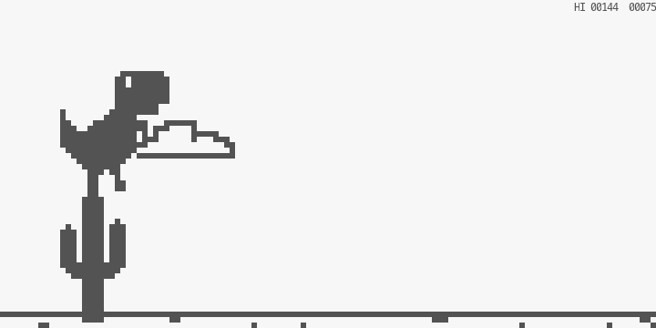

<h1 align="center">rex-run</h1>

<p align="center">
  Chrome's offline dinosaur, in your terminal &mdash; with Chrome's actual dinosaur.
</p>

<p align="center">
  <a href="https://github.com/Pallavrai/rex-run/actions/workflows/ci.yml"></a>
  <a href="LICENSE"></a>
  
  
</p>



Every terminal T-Rex clone gets the *game* roughly right and the *dino* wrong:
a hand-drawn ASCII blob with the wrong proportions, no night mode, no
pterodactyls. What makes Chrome's offline game memorable is the exact
silhouette and the exact feel, and neither survives being redrawn by hand.

So rex-run doesn't redraw it. Chromium's dino game is open source, sprite
sheet included, so this is a **port**: the real sprite pixels, the real
physics constants, the real collision boxes, rendered at native resolution in
a terminal.

## Install

```bash
cargo install --git https://github.com/Pallavrai/rex-run
```

Or grab a prebuilt binary from [Releases](https://github.com/Pallavrai/rex-run/releases),
or build it yourself:

```bash
git clone https://github.com/Pallavrai/rex-run
cd rex-run
cargo run --release
```

Needs a terminal at least 60x24, and one that can draw `▀` (any terminal from
this century).

**Make the window 300x38 and you get Chrome's canvas exactly** &mdash; same
field of view, same proportions, same speed. The play area is capped there, so
a bigger window gets margins rather than a wider world than the browser ever
had; a smaller one shrinks to fit and shows less of the world, which makes the
T-Rex look proportionally larger. The start screen tells you the size to aim
for.

## Controls

| key | |
|---|---|
| <kbd>space</kbd> / <kbd>↑</kbd> | jump &mdash; hold for a higher one |
| <kbd>↓</kbd> | duck, or drop out of a jump |
| <kbd>space</kbd> / <kbd>enter</kbd> | restart after a crash |
| <kbd>q</kbd> / <kbd>esc</kbd> / <kbd>ctrl-c</kbd> | quit |

`rex-run --slow` plays Chrome's slow mode: gentler acceleration, wider gaps,
night falling at 350 points instead of 700.

## What's in it

Everything the browser has, minus the sounds:

- the T-Rex, running, jumping, ducking, blinking while it waits, and the
  crashed pose with the dead eye
- small and large cacti, in groups of one to three
- pterodactyls at three heights, unlocked at the same speed as Chrome
- clouds, a moon that runs through all seven phases, and stars
- night mode at every 700 points, lasting Chrome's twelve seconds: the
  colours invert, exactly as the browser inverts its canvas
- the score flashing every hundred points, and a high score that survives
  quitting

## How it works

**Two pixels per cell.** A terminal cell is about twice as tall as it is wide,
so `▀` with a foreground and a background colour is two *square* pixels
stacked. That is the whole renderer: a 1-bit framebuffer, and a diff that
repaints only the cells that changed.

**Never resample.** Chrome's T-Rex is 44x47 pixels, which would swallow most
of an 80x24 terminal. Every sprite is therefore reduced 2:1 exactly once,
offline, by `tools/gen_sprites.py`, using a rule tuned per sprite so hairlines
survive and the dino keeps its eye; the result is committed as
`src/sprites.rs`. Nothing is ever scaled at runtime, which is what saves the
silhouette &mdash; scaling an already-tiny sprite is where the other clones
turn to mush.

**The HUD is pixels too.** Chrome's 10x13 digits are mush at half size, so
the score and the game-over panel are drawn into the framebuffer with a 3x5
font instead of printed as terminal text. They keep the game's proportions at
any window size, and they invert with night mode like everything else.

**One bit.** Chrome draws everything in one ink colour on one paper colour
&mdash; the T-Rex's eye is a white pixel punched through its head, not a hole
&mdash; so the framebuffer is a bitmap and night mode is those two colours
swapped, which is exactly what the browser does to its canvas.

**Ported, not rewritten.** Gravity 0.6, initial jump velocity -10, speed 6
accelerating by 0.001 a frame to 13, gap coefficient 0.6, pterodactyls at 8.5,
`1000/12` ms per running frame, and Chrome's per-sprite collision boxes with
its ducking adjustment. The numbers are the browser's, and the game logic
never touches the terminal, so it runs headless in tests &mdash; including a
seeded 2400-frame run whose final score is asserted exactly.

**A fixed play area.** Two world pixels to a column and four to a row makes
Chrome's 600x150 canvas exactly 300x38 cells, and the game never draws a
larger world than that: on a bigger terminal the play area is centred and the
rest is margin, so the game looks the same everywhere above that size instead
of sprawling.

**The clock bends, not the world.** Below 300 columns the play area shrinks,
and a 120-column terminal is 240 world pixels wide where Chrome has 600 --
less room to see an obstacle coming. Shrinking the world's *geometry* would
leave jumps too short to clear anything, so instead the simulation clock runs
slower by the same ratio: identical jump arcs, identical scores per obstacle,
just more seconds of warning.

### Where it differs from Chrome

| | Chrome | rex-run |
|---|---|---|
| world | 600x150 | the same, on a 300x38 terminal; smaller windows see less of it, sky cropped first |
| clock | 60 fps | 60 fps, slowed on terminals narrower than 600 world pixels |
| jump apex | near the top of the canvas | capped to the visible sky below 38 rows |
| score and game-over text | 10x13 sprites from the sheet | a 3x5 pixel font, drawn in the framebuffer &mdash; Chrome's digits are unreadable at half size |
| night mode | fades over the canvas | 400 ms colour cross-fade |
| key release | `keyup` | real key-up events on terminals speaking the kitty keyboard protocol, otherwise an auto-repeat timeout |
| sound | three effects | none |

## Development

```bash
cargo fmt --all && cargo clippy --all-targets -- -D warnings && cargo test
```

`tools/screenshot.py` plays the real binary inside a pseudo-terminal and
prints the frame as text or saves it as a PNG &mdash; useful for rendering
bugs, and how the screenshot above was made. See
[CONTRIBUTING.md](CONTRIBUTING.md).

## Credits

The sprites and the game constants are from
[Chromium's offline game](https://chromium.googlesource.com/chromium/src/+/main/components/neterror/resources/dino_game/),
BSD-3-Clause, by The Chromium Authors &mdash; see [NOTICE](NOTICE). The
original game was made by Sebastien Gabriel, Alan Bettes and Edward Jung.

rex-run itself is MIT licensed, and is not affiliated with, endorsed by, or
sponsored by Google.
